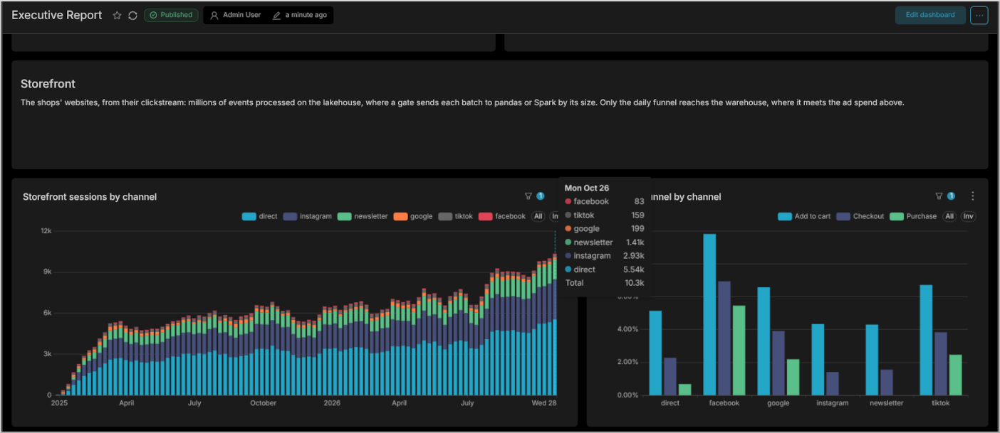
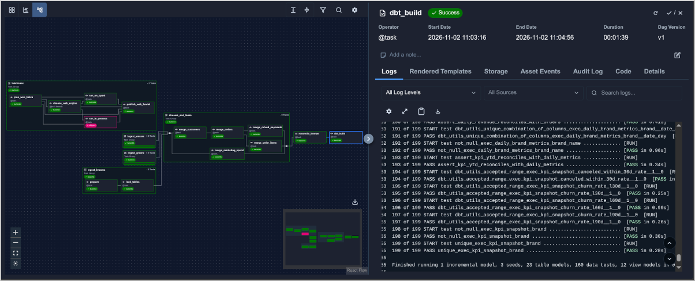
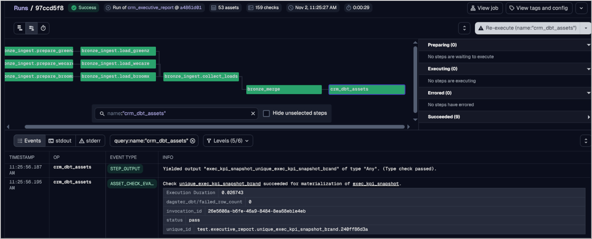
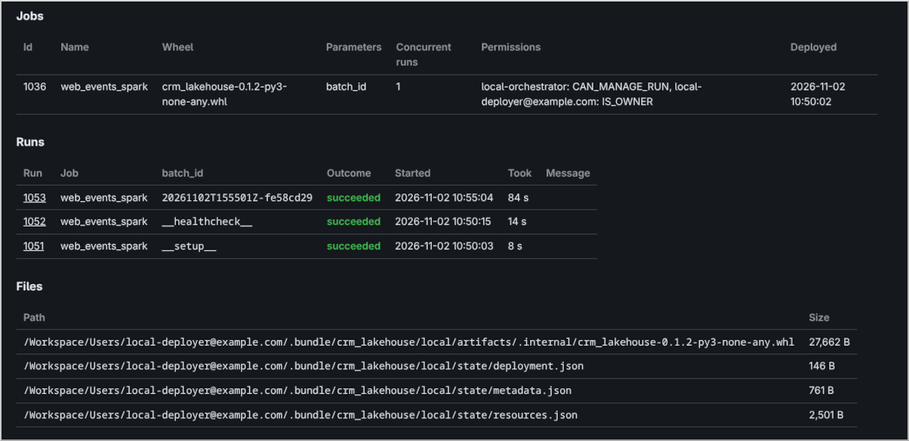

# Commerce Analytics Pipeline

### PostgreSQL => Airflow or Dagster => Snowflake/dbt => Superset, with Spark/Databricks

Subscription e-commerce analytics pipeline demo from the very beginning until dashboard. Using Postgres, Snowflake, dbt, Superset, and Delta lakehouse with Spark. Dagster is included as an alternative to Airflow.

Three fictional subscription brands run their shops on CRM databases. This repo turns those
databases into one executive report: revenue, contribution margin, new customers, active and
cancelled subscriptions, churn, rebuy rates, contribution margin per customer cohort, and what each
ad channel costs per customer against what those customers bring back.

Airflow orchestrates the DAGs (Dagster is included as alternative), the
pipeline is the same, and either orchestrator can run it, one at a time, with Airflow being the
default. Snowflake holds the medallion layers, dbt builds the star schema and the reporting
marts, and Superset renders the dashboard from tables that already have the shape of each chart.

Every morning a new day of shop activity arrives, only the changed rows are loaded, a stream and
merge task carry them into bronze, a reconciliation against the source stops anything that does
not add up, and dbt runs. When gold is ready, a third job posts the KPI digest and checks the
dashboard.

The fictional shops' websites also send a clickstream: millions of semi-structured events.
They are processed on a lakehouse of Delta tables, by pandas or by Spark (a Databricks job),
depending on the job size, and only the daily funnel reaches
Snowflake.


The whole chain runs locally with fictional data: **PostgreSQL** in a container, **fakesnow** as the
Snowflake emulator, Airflow or Dagster and dbt in virtualenvs, and **Superset** with a SQLite
metadata database. Nothing outside the repo is required. Only one orchestrator runs at a time.

It runs on your local machine with fictional data, and no real
Snowflake, Databricks or CRM account is connected to this repository. If you plan to test on real systems, check section 7 in this README.

The lakehouse workflow runs its checks on pull requests, and skips its `release` and `deploy` jobs until the repository variable `DATABRICKS_HOST` is configured.

## 1. Source system

The source is a normalized CRM schema. Amounts are integer cents, timestamps are UTC, and flags
are `BOOLEAN`. The business runs on New York time, so every date the report uses (the day of an
order, a cancellation or a refund, and the as-of date) is the New York calendar day of the UTC
timestamp (`business_date` in
[`dbt/macros/reporting_helpers.sql`](dbt/macros/reporting_helpers.sql), var `business_timezone`). The generated SQL file is
[`local/source_db/fake_crm.sql`](local/source_db/fake_crm.sql), a psql script: it creates the
three databases, drops and recreates every table with its foreign keys and inserts deterministic
fake rows. Regenerate it with
`python local/source_db/generate_fake_crm.py`.

| Table              | Grain                                 | What it holds                                                                                                                  |
| ------------------ | ------------------------------------- | ------------------------------------------------------------------------------------------------------------------------------ |
| `customers`        | one customer                          | sign-up, country, newsletter flag. `email` is PII and is never copied to bronze                                                |
| `products`         | one product                           | catalogue name, SKU, warehouse SKU, cost SKU                                                                                   |
| `product_variants` | one variant                           | variant code, price; the code encodes subscription (`vip`) and upsell (`-u`)                                                   |
| `product_costs`    | one cost SKU                          | fulfilment cost per first/additional unit and shipping                                                                         |
| `processing_costs` | one row per brand                     | processing cost of the first and each additional item                                                                          |
| `orders`           | one order (carts included)            | state, totals, subscription flags, acquisition fields                                                                          |
| `order_items`      | one order line                        | variant, quantity, unit price, discounts                                                                                       |
| `refund_payments`  | one refund                            | amount, state, reason, issue time; linked by order number                                                                      |
| `marketing_spend`  | one day × channel × medium × campaign | ad spend, impressions, clicks, imported from the ad platforms. No key to the other tables: it meets the orders on `utm_source` |

**Source tables hold raw application data only.** dbt computes them: `acquisition_type`, `is_paused_excluding_cancelled`,
`refund_amount_excl_vat`, dates through `dim_dates`.

## 2. Medallion Architecture

- **The CRM** (left): Postgres is the source system. Airflow or Dagster copies the
  changed rows into Snowflake's bronze, and dbt sends its SQL to Snowflake, so silver and gold are
  built inside the warehouse.
- **The storefront clickstream** (right) has its own bronze, silver and gold in the lakehouse, as
  Delta tables. For each batch, the gate (depending on the job size) decides whether pandas or Spark (a
  Databricks job) builds them. Only its gold, the daily funnel, is copied into Snowflake
  (`RAW.WEB`), where dbt joins it with the orders and the ad spend.

Superset then reads Snowflake's gold.

For each table and brand, the loader writes a staging table and checks that it holds exactly the rows read
from the source, so a duplicated or lost batch is never published. The four reference tables are then replaced: the loader refuses to replace a non-empty brand slice with an empty export, and deletes and inserts that brand's rows in one
transaction, so readers see the old copy or the new one.

Customers, orders, order items, refunds and ad spend are loaded incrementally by the same task.
One task per brand reads all nine of its tables in one read-only snapshot of the database
(`REPEATABLE READ`), so on a shop that keeps taking orders during the load, an order line is
never copied without its order or the product variant it points at. What `RAW.CRM` holds is
read once per load, in one catalog query, and a table is created or widened only when it lacks
something. The DAG also checks that every table exists before loading, compares bronze with the source after the merges, and dbt source freshness stops the build if bronze has not been refreshed. A dbt test checks that every foreign key in bronze finds its row (an order line whose order is missing would otherwise drop out of revenue).

The brand registry is one file, [`dbt/seeds/brands.csv`](dbt/seeds/brands.csv). The DAG reads it
to decide which brands to extract and from which database; dbt reads it for currency and VAT
rules (the two brands WeCare and Greenz sell in GBP and include 20% VAT, while Broomx sells in USD without VAT). A brand
with `load_from_source = false` gets no ingest group and is expected to be in bronze already.

## 3. The executive report



Every `exec_*` gold table is pre-built specifically for the Superset dashboard: dbt handles all the business rules upfront so the dashboard only needs to add totals (`SUM`), average percentages (`AVG`), or pick a single value (`MAX`) and group dates by day, week, or month.

The only exception is period churn: because churn percentages can't be added across brands, the dashboard calculates it by dividing the total subscribers lost by the total subscribers active at the start of the period. Every table includes `brand` and `brand_name`, so the single **Brand** dropdown filter (`filter_select` on `brand_name`) at the top of the dashboard filters all charts at once.

| Charts                                                                                                                                                                                                                   | Gold table                                                                       | Grain                                     | Metric                                                                                                                                                                           |
| ------------------------------------------------------------------------------------------------------------------------------------------------------------------------------------------------------------------------ | -------------------------------------------------------------------------------- | ----------------------------------------- | -------------------------------------------------------------------------------------------------------------------------------------------------------------------------------- |
| 5 historical trend charts: weekly revenue, contribution margin, new customers, and ad spend; monthly new / cancelled / net subscriptions                                                                                 | `exec_daily_brand_metrics`                                                       | brand × day                               | `SUM(revenue_usd)`, `SUM(contribution_margin_usd)`, `SUM(new_customers)`, `SUM(ad_spend_usd)`, `SUM(new_subscriptions)`, `SUM(canceled_subscriptions)`, `SUM(net_subscriptions)` |
| Active subscriptions (weekly trend)                                                                                                                                                                                      | `exec_active_subscriptions_weekly`                                               | brand × week                              | `SUM(active_subscriptions)`                                                                                                                                                      |
| Subscribers left after N days (retention curve)                                                                                                                                                                          | `exec_subscription_survival`                                                     | brand × day 0–200                         | `MAX(subscribers_left_rate)`                                                                                                                                                     |
| Rebuy % after N days (repeat-order curve)                                                                                                                                                                                | `exec_rebuy_curve`                                                               | brand × day 0–200                         | `MAX(rebuy_rate)`                                                                                                                                                                |
| Contribution margin per customer by cohort (pivot table)                                                                                                                                                                 | `exec_cohort_contribution_margin`                                                | brand × first-order month × 30-day period | `AVG(contribution_margin_per_customer_usd)`                                                                                                                                      |
| KPI summary cards at the as-of date (as-of date, MTD/PMTD/YTD/PYTD revenue & contribution margin, MTD/PMTD & L30D/L60D/L90D customers, L30D–L180D net subscriptions, L30D–L90D period churn, 30/60/90-day cancellations) | `exec_kpi_snapshot`                                                              | brand                                     | `MAX(as_of_date)` for the as-of date, `SUM(...)`, `SUM(lost_subscriptions_lNd) / SUM(active_subscriptions_start_lNd)` for churn, or `AVG(...)` for cancelled within N days       |
| Live orders and sales on the latest day, with the daily trend                                                                                                                                                            | `exec_daily_orders_live` (a view over the dynamic table `fct_daily_orders_live`) | brand × day                               | `SUM(orders)`, `SUM(sales_usd)`                                                                                                                                                  |
| CAC and 90-day LTV by channel, 90-day LTV : CAC by channel                                                                                                                                                               | `exec_channel_cac_ltv`                                                           | brand × channel                           | `AVG(cac_usd)`, `AVG(ltv_90d_usd)`, `MAX(ltv_to_cac_ratio)`                                                                                                                      |
| Storefront sessions by channel (weekly)                                                                                                                                                                                  | `exec_web_daily_sessions` (from the clickstream)                                 | brand × day × channel                     | `SUM(sessions)`                                                                                                                                                                  |
| Storefront funnel by channel, last 90 days                                                                                                                                                                               | `exec_web_channel_funnel` (from the clickstream)                                 | brand × channel                           | `AVG(add_to_cart_rate)`, `AVG(checkout_rate)`, `AVG(conversion_rate)`                                                                                                            |

**Revenue** is gross sales excluding VAT minus refunds issued during that period, while **contribution margin** subtracts order fulfillment, shipping, and processing costs before ad spend or overheads.

The live **Sales** tile shows paid order totals excluding VAT before refunds, whereas customer-level views (LTV and the cohort table) attach each refund back to its original order on `fct_orders`. The **cohort table** tracks cumulative contribution margin per new customer in 30-day periods from their first paid order, displaying a period only once every customer from that acquisition month has completed it. For **CAC and 90-day LTV** (`exec_channel_cac_ltv`), each customer is assigned to their first order's paid `utm_source` (or `organic`) across a 365-day acquisition window ending 90 days before the as-of date, giving every customer a full 90 days to order again. Comparing 90-day contribution margin (LTV) against ad spend per acquired customer (CAC) shows whether a channel pays for itself within 90 days (a ratio of `1` or above), and a dbt test ensures channel spend reconciles with `fct_marketing_spend`.

The dashboard presents two complementary views of churn: **Churn LnD** measures period retention by taking the subscribers active _N_ days ago and calculating the share lost since (ignoring subscriptions that started inside the window). Meanwhile, **Cancelled within N days** follows new subscriptions from their start date, measuring the share of subscriptions at least _N_ days old that cancelled in their first _N_ days, which also feeds the subscribers-left survival curve.

When multiple brands are selected, **Churn LnD** pools all lost and active subscribers across brands, whereas `AVG` is used deliberately on the cancelled-within-_N_-days cards, the cohort table, CAC, and LTV to average the per-brand values.

## 4. Run the end to end pipeline locally

Needs Linux or macOS, `uv`, podman or docker, and Java 17 or later.

```sh
scripts/local.sh install
scripts/local.sh fullrun ## might take ~15-20 minutes to complete the first time
```

Running `scripts/local.sh install` calls the `ensure_local_env()` function in [`scripts/local.sh`](scripts/local.sh), which automatically creates the local `.env` file by copying [`.env.local.example`](.env.local.example) and appending randomly generated `AIRFLOW_PASSWORD` and `SUPERSET_PASSWORD` credentials. Every `scripts/local.sh` command (including `scripts/local.sh fullrun`) then automatically sources `.env` on startup.

`fullrun` runs the demo through the Airflow scheduler, brings up every UI in localhost, and when the dashboard
is ready, it opens the three of them as browser tabs:

| UI                         | URL                   | Shows                                                                             |
| -------------------------- | --------------------- | --------------------------------------------------------------------------------- |
| Superset                   | http://127.0.0.1:8088 | the Executive Report (admin, password in `.env`)                                  |
| Airflow                    | http://127.0.0.1:8080 | the report run fullrun started, with every task's log (admin, password in `.env`) |
| Local Databricks workspace | http://127.0.0.1:8770 | the deployed lakehouse job, and each Spark run with its log                       |

In order, it:

1. starts PostgreSQL and fakesnow, using `scripts/local.sh airflow`
2. starts the local Databricks workspace. If no lakehouse job is deployed there yet, it releases
   and deploys one (`lakehouse release` and `lakehouse deploy -t local`, the release runs the
   lakehouse tests, so the first time takes a few minutes). A batch the gate sends to Spark then
   runs the deployed job, as on Databricks.
3. writes the missing days of shop activity and the clickstream files, using `scripts/local.sh airflow`.
4. starts Airflow (`airflow standalone`) and Superset in the background, logging to
   `.local/airflow.log` and `.local/superset.log`.
5. switches `crm_executive_report` on and triggers it ([`local/airflow_run.py`](local/airflow_run.py)).
   The scheduler runs it, so the UI has every task's log, which the `dags test` runs of
   `scripts/local.sh airflow` do not leave. fullrun prints each task as it finishes.
6. rebuilds the storefront tables from what that run published, imports the dashboard, then switches
   `crm_executive_activation` on and triggers it.
7. opens the tabs in your default browser.

### If you prefer to simulate the runs step by step

```sh
scripts/local.sh install
scripts/local.sh airflow    # the demo, then the UI
```

`scripts/local.sh airflow` starts PostgreSQL and fakesnow, writes every missing day of shop
activity up to yesterday (one `crm_daily_activity` run per day), runs the report DAG once
(`dags test`, no scheduler), builds and imports the dashboard, runs the activation DAG, which logs
the KPI digest, and then starts the Airflow UI and scheduler. Run it again on a later day and it
adds the days in-between, and loads only what changed.

Example of a successful Airflow DAG run:


The same demo can be simulated on Dagster:

```sh
scripts/local.sh dagster    # the demo, then the UI and daemon
```

`dagster simulate`, `dagster pipeline` and `dagster <args>` mirror the Airflow commands. Airflow
and Dagster share the same source, the warehouse and the stream offsets.

IMPORTANT: only one orchestrator may run at a time (either you use Airflow or Dagster): `scripts/local.sh` refuses to start either while the other is running and `status` shows both the running orchestrator and which one built the current gold.

Example of a successful Dagster DAG run:


The Superset dashboard has a UI of its own. Start it in another terminal:

```sh
scripts/local.sh superset
```

Individual steps:

```sh
scripts/local.sh source-db up      # Postgres, reloads fake_crm.sql when it changed
scripts/local.sh source-db reset   # remove the container and its volume, then start fresh
scripts/local.sh warehouse up      # fakesnow
scripts/local.sh simulate          # write the missing days of shop activity, up to yesterday (Airflow)
scripts/local.sh pipeline          # the report DAG once, then the activation DAG (Airflow)
scripts/local.sh dagster simulate  # the missing days as one Dagster backfill
scripts/local.sh dagster pipeline  # the clickstream and report jobs once, then the activation job (Dagster)
scripts/local.sh dashboard         # build + import the Superset bundle
scripts/local.sh dbt build --select tag:gold   # build and test the gold dbt models
scripts/local.sh test              # pytest in .venv and .venv-dagster
scripts/local.sh status            # what is running (the local Databricks workspace too), and which orchestrator built gold
scripts/local.sh stop airflow      # kill Airflow (or: stop dagster) and every process it started, at once
scripts/local.sh down              # stop PostgreSQL and fakesnow
```

With the scheduler running (`scripts/local.sh airflow ui`), switch on `crm_daily_activity`,
`crm_executive_report` and `crm_executive_activation` in the UI: the first catches up on any
missing days and then runs every morning at 07:00 New York time, each finished day starts the
second, and each rebuilt gold starts the third. In `scripts/local.sh dagster ui`, switch on the
activity schedule and the two sensors for the same chain; all schedules and sensors start
stopped, as Airflow's DAGs start paused. Without the daemon, the CLI runs the report and
activation jobs itself.

The clickstream adds a few commands (Spark needs Java 17 or later):

```sh
scripts/local.sh lakehouse workspace up   # a local stand-in for a Databricks workspace
scripts/local.sh lakehouse release -t local    # build, test, audit, plan: the evidence
scripts/local.sh lakehouse deploy -t local     # deploy that release's reviewed plan, then verify it
scripts/local.sh lakehouse status         # waiting files, table sizes, each batch and its engine
```

The demo generates the clickstream history the first time. The next
report run sends it to Spark, and every later daily batch stays in pandas.

### Source SQL script

`local/source_db/fake_crm.sql` is the runnable SQL the architecture starts from, a psql script.
It contains, for each brand DB:

- `CREATE DATABASE crm_<brand>` when it does not exist yet (psql's `\gexec`), then `\connect`
- `DROP TABLE IF EXISTS` and `CREATE TABLE` for the 9 tables, with primary keys, unique
  constraints, indexes and the 7 foreign keys
- `INSERT INTO ... VALUES` batches, parents before children, explicit deterministic ids, then
  `setval` on each id sequence
- a `zz_users.sql` read-only Airflow user

`scripts/local.sh source-db up` keeps a checksum of the seed SQL in the database volume. When
`fake_crm.sql` changes, it reloads the databases, so a regenerated file can never be silently
ignored.

### Re-run the entire pipeline with fresh install

If you ever need to re-run the entire pipeline again with fresh install, use these commands to clean up the environment first:

```sh
scripts/local.sh down
podman rm -f crm-source
podman volume rm crm-source-pgdata
git clean -xdf

# then, we can install and do fullrun again
scripts/local.sh install
scripts/local.sh fullrun
```

If for whatever reason fullrun doesn't work due to previous instance of your databricks workspace or fakesnow, just kill all processes of databricks workspace `pkill -9 -f databricks_workspace.py`, as well as fakesnow `pkill -9 -f fakesnow`, and re-run `scripts/local.sh fullrun`.

## 6. Testing

- **pytest** (`scripts/local.sh test`): Verifies DAG integrity, incremental loading, stream merges, source reconciliation, simulator rules, and lakehouse engine parity across `.venv` (Airflow), `.venv-dagster` (Dagster), and `.venv-spark` (Spark).
- **Dagster definitions** (`tests/dagster`): Checks that all Dagster assets, ops, merge ordering, blocking reconciliation checks, schedules, sensors, and concurrency tags load and behave as expected.
- **dbt on every build**: Runs primary-key, foreign-key, accepted-range, SCD2 state-history, source-freshness, unit (on real Snowflake), and cross-table financial and funnel reconciliation tests on every build.
- **Superset smoke test** (`local/superset/check_dashboard.py`): Queries every dashboard chart through the Superset API after each gold rebuild and confirms that the native **Brand** filter covers and filters all datasets.

## 7. Running against real systems

For running against real systems, don't use the automatically created `.env` file. Copy [`.env.example`](.env.example) to `.env` and set a real Snowflake account and CRM server.
The same DAGs or Dagster job, loader, dbt models and Superset bundle run unchanged: local points
at fakesnow, real deployments point at Snowflake. The loader uses `write_pandas` on real Snowflake
for chunks of 2,000 rows or more and INSERT statements for smaller ones (a day's changes, the
reference tables), which skip write_pandas's stage, upload and COPY. It uses INSERT statements for
everything when the connection extra says `load_method: insert`, which the emulator needs because
its server has no file transfer.

With a `slack_webhook` connection, failure alerts and the executive digest go to Slack;
without one they are logged. `SUPERSET_URL`, `SUPERSET_USERNAME` and `SUPERSET_PASSWORD` point
the dashboard check at another Superset.

The export service (`crm_export_api`) is optional. When it is configured the pipeline refreshes
each brand's snapshot first; when it is absent the export task logs that it is skipping and uses
the database as it is.

## 8. Using Spark: the clickstream on a lakehouse

The three shops' websites export daily clickstream events (page views, product views, add to cart, checkout, and purchase) as gzipped JSON-lines files into a lakehouse landing volume. Before running each batch of new files, a gate in [`lakehouse/src/crm_lakehouse/planning.py`](lakehouse/src/crm_lakehouse/planning.py) checks whether the batch fits within the orchestrator worker's memory budget and logs its decision to the batch ledger (`bronze.web_event_batches`). Routine daily batches that fit in memory run directly inside the worker using `pandas` and `delta-rs` without starting a cluster, whereas larger backlogs or historical backfills are routed to `Spark` as a serverless Databricks job (with automatic fallback to Spark if an in-process run ever fails).

Both [`pandas_engine.py`](lakehouse/src/crm_lakehouse/pandas_engine.py) and [`spark_engine.py`](lakehouse/src/crm_lakehouse/spark_engine.py) follow the single data contract in [`contract.py`](lakehouse/src/crm_lakehouse/contract.py) to build the exact same Delta Lake medallion tables (`bronze.web_events`, `silver.web_events`, and `gold.web_daily_funnel`). Each batch appends raw lines to bronze, validates and deduplicates events into silver via `MERGE` while recording per-rule drop counts in the ledger, and atomically replaces the affected New York session-start days in the gold daily funnel (`replaceWhere`). Because both engines read and write the same Delta tables and track ingested files in bronze rather than a Spark-only checkpoint, [`lakehouse/tests/test_engine_parity.py`](lakehouse/tests/test_engine_parity.py) verifies that pandas alone, Spark alone, and alternating runs produce identical bronze, silver, and gold tables.

Once the lakehouse gold table is updated, `publish_web_funnel` copies only the aggregated daily funnel and batch summaries into Snowflake (`RAW.WEB.DAILY_FUNNEL` and `RAW.WEB.EVENT_BATCHES`), where dbt joins storefront sessions and conversion rates with CRM orders and marketing spend (`exec_web_daily_sessions` and `exec_web_channel_funnel`) without blocking the main CRM report if a clickstream batch is delayed. For Spark execution on Databricks, the lakehouse package is shipped as a Databricks Asset Bundle through [`scripts/lakehouse_release.py`](scripts/lakehouse_release.py) and [`.github/workflows/lakehouse.yml`](.github/workflows/lakehouse.yml).

Example of local Databricks workspace running the job:


## 9. Agent Skills

If you plan to use AI agents to seamlessly integrate new features to this repo, you can check [SKILL.md](.agents/skills/pipeline-change/SKILL.md). The skill has been improved and tested over time, with known pitfalls, and specific wordings for the agents to follow.
